<p align="center">
  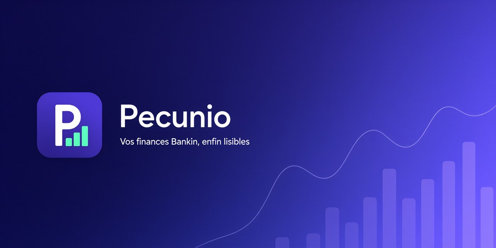
</p>

<p align="center">
  <a href="https://chromewebstore.google.com/detail/pecunio/jeomdpldhaigmdbjobamliaipijhmiie?github"></a>
  <a href="https://chromewebstore.google.com/detail/pecunio/jeomdpldhaigmdbjobamliaipijhmiie?github"></a>
  <a href="https://github.com/Thorfy/Pecunio/actions/workflows/ci.yml"></a>
</p>

<p align="center">
  <b>Pecunio</b> est une extension Chrome qui ajoute à <a href="https://app2.bankin.com">Bankin</a> les graphiques qui lui manquent :<br>
  évolution de vos dépenses, comparaison de budget, flux financiers, types de dépenses, export CSV et rapport PDF.
</p>

<p align="center">
  <a href="https://chromewebstore.google.com/detail/pecunio/jeomdpldhaigmdbjobamliaipijhmiie?github"><b>Installer depuis le Chrome Web Store →</b></a>
</p>

---

## Ce que Pecunio ajoute à Bankin

### Sur la page Comptes

**Vos revenus et dépenses mois par mois**, avec le **solde de chaque mois** : les 5 catégories de dépenses principales et « Autres », sur 6, 12 ou 24 mois (ou tout l'historique). Un clic affiche toutes les catégories ou passe en courbes ; un clic dans la légende masque une catégorie.

<p align="center">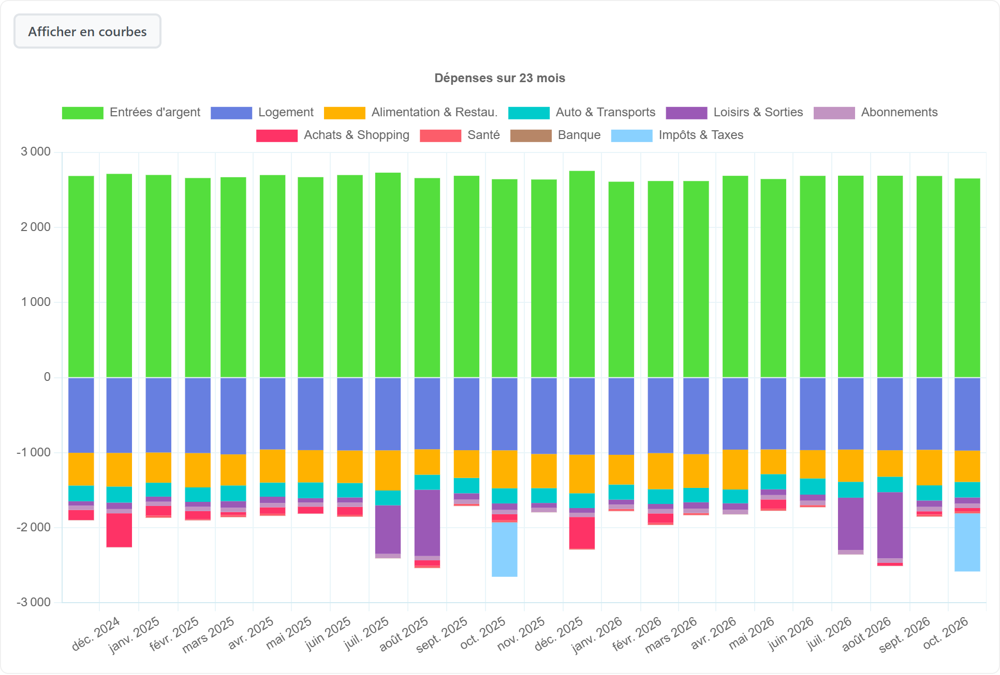</p>

**Votre épargne mois par mois** : le solde de chaque mois (vert quand vous mettez de côté, rouge en cas de déficit) et votre taux d'épargne, sur la même période.

<p align="center">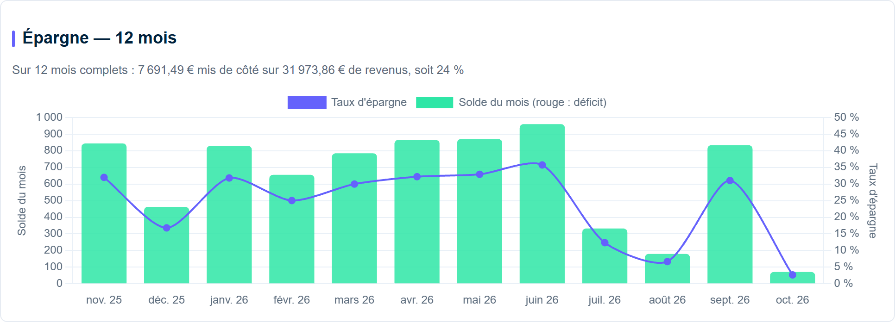</p>

**La comparaison du budget** : le mois dernier (ou le mois en cours) face à la médiane des 12 mois précédents, ou cette année face à l'an dernier. Dépenses triées par catégorie, total et écart en un coup d'œil ; « Personnaliser » pour choisir d'autres périodes.

<p align="center">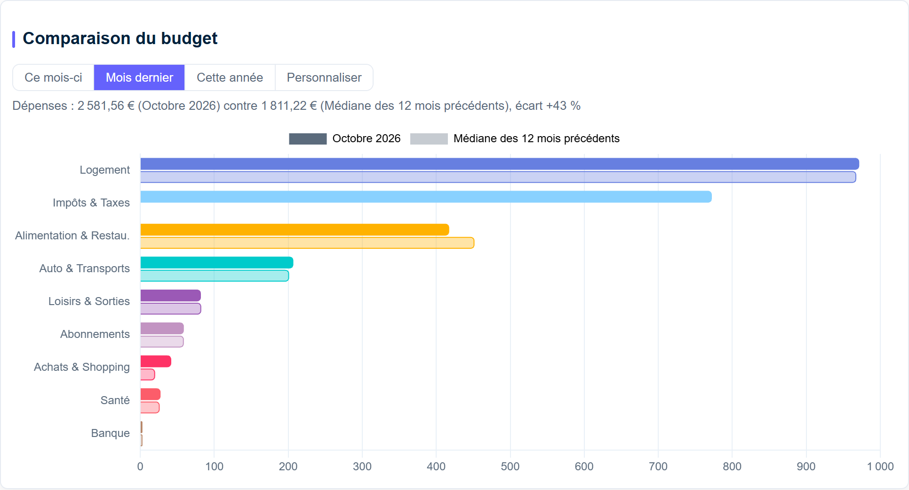</p>

### Sur la page Catégories

**Les flux financiers du mois** : d'où vient l'argent, où il part, jusqu'aux sous-catégories, et ce qu'il reste. Et **la répartition par type** : essentiel, plaisir, épargne.

<table>
  <tr>
    <td width="66%">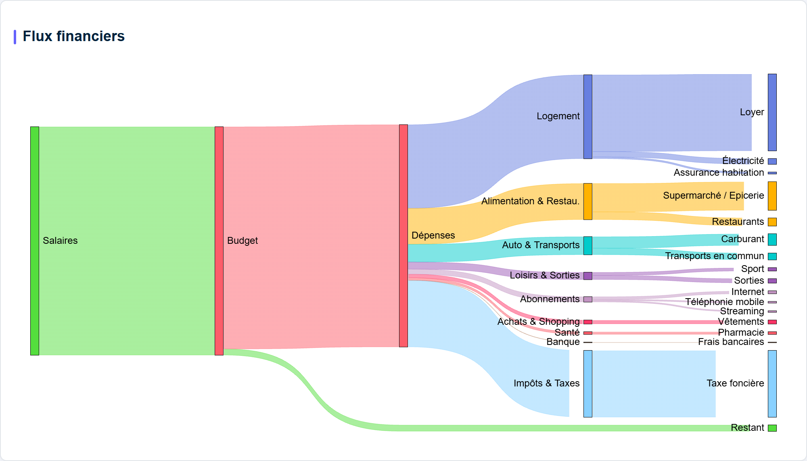</td>
    <td width="34%">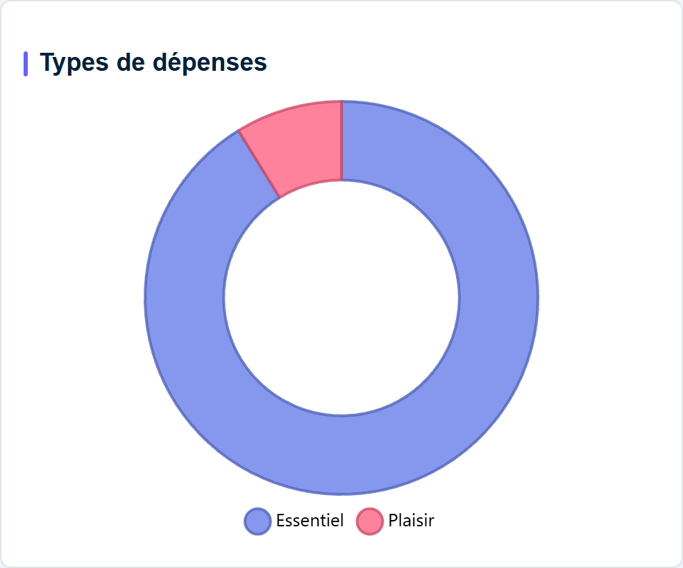</td>
  </tr>
</table>

**Le rythme du mois et les plus fortes variations** : vos dépenses cumulées jour après jour face à votre rythme habituel, et les catégories qui s'écartent le plus de leur habitude. Qu'est-ce qui a dérapé ce mois-ci ?

<table>
  <tr>
    <td width="64%">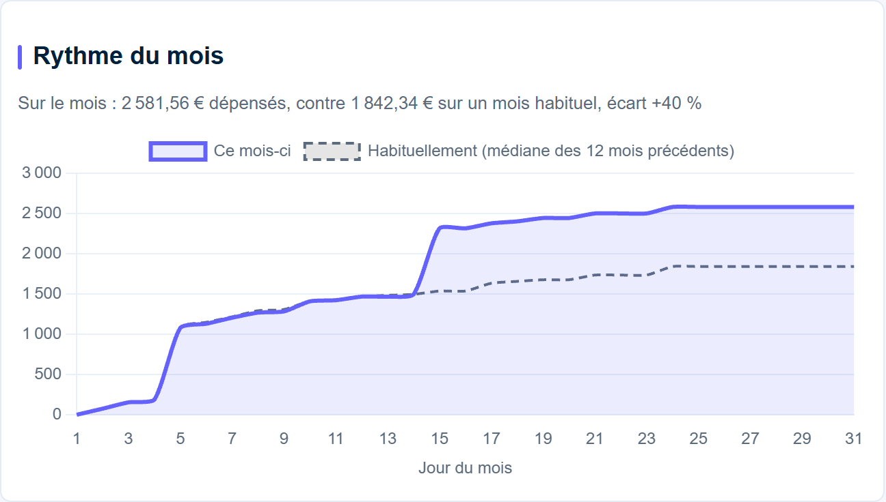</td>
    <td width="36%">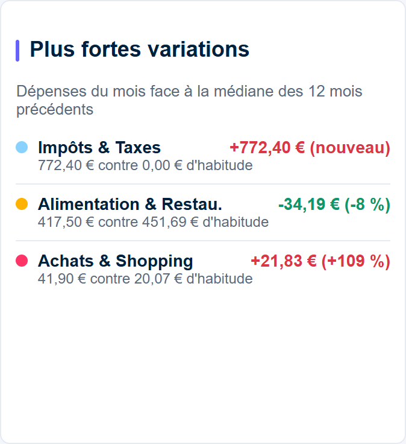</td>
  </tr>
</table>

### Sur le détail d'une catégorie

**L'historique sur 12 mois**, par sous-catégorie, avec la médiane et le mois affiché mis en avant : vos courses augmentent-elles ? Sur l'onglet Revenus, l'évolution de vos revenus par source.

<p align="center">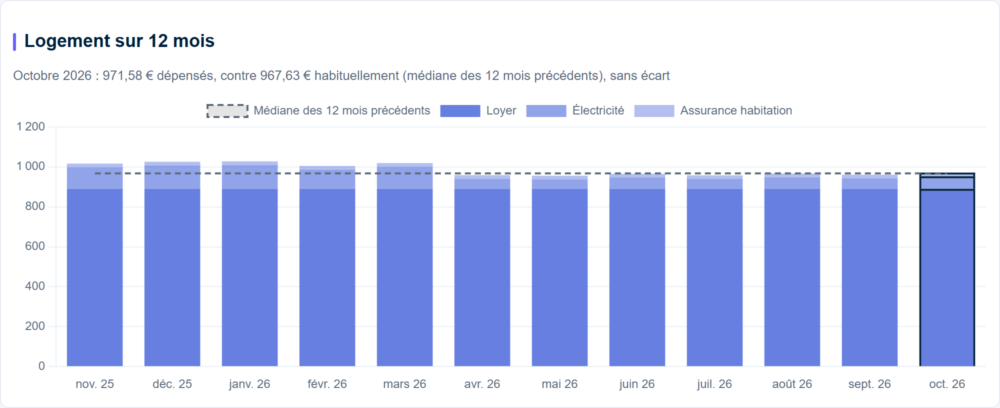</p>

### Dans la popup et le rapport

<table>
  <tr>
    <td width="30%" valign="top">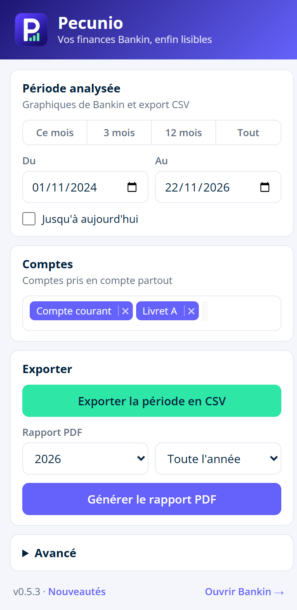</td>
    <td width="70%" valign="top">
      <p><b>La popup</b> règle la période (ce mois, 3 mois, 12 mois, tout ou dates libres) et les comptes analysés, et exporte :</p>
      <ul>
        <li><b>CSV</b> : toutes vos transactions de la période, avec la vraie date et le mois de rattachement choisi dans Bankin, prêtes pour un tableur ;</li>
        <li><b>Rapport PDF</b> : un bilan mensuel ou annuel (revenus, dépenses, solde, taux d'épargne et solde mois par mois, répartitions, flux, évolution, détail des transactions).</li>
      </ul>
      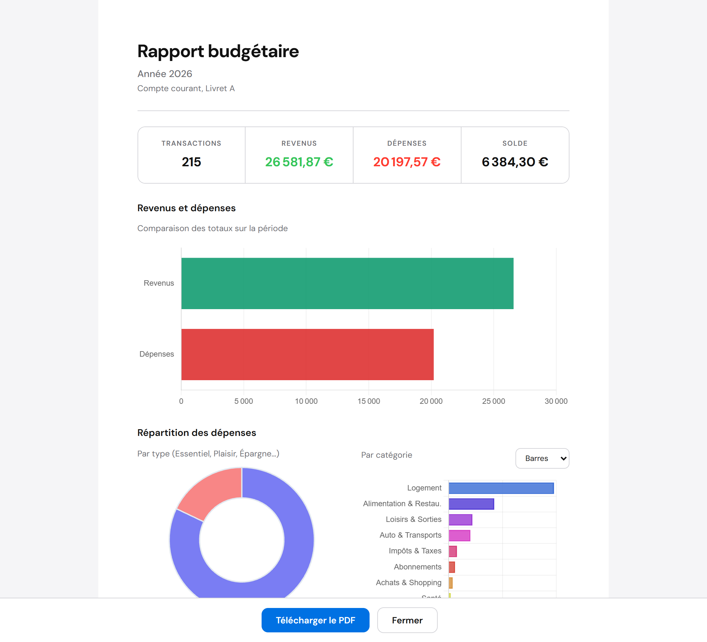
    </td>
  </tr>
</table>

### Et aussi

- **Masquage des montants** : un clic sur l'œil à côté du solde floute les montants de la page et des graphiques. Pratique pour montrer son écran.
- **Interface en français**, montants au format `1 234,50 €`, boutons utilisables au clavier.
- **Plusieurs onglets Bankin** ouverts en même temps : chacun affiche ses graphiques.

## 🔒 Vos données restent chez vous

- Pecunio lit vos données avec la session Bankin de votre navigateur. **Rien n'est envoyé ailleurs que vers Bankin** : pas d'analytics, pas de serveur Pecunio.
- Les transactions sont gardées en cache sur votre ordinateur (`chrome.storage.local`) pour afficher les graphiques plus vite.
- **Dès que Bankin affiche sa page de connexion** (déconnexion ou session expirée), Pecunio efface ce cache, le dernier rapport et les en-têtes d'authentification. Seules vos préférences (période, comptes, catégories masquées, masquage des montants) sont conservées.
- Les boutons « Réinitialiser » de la popup effacent à la demande les données ou les préférences.
- Permissions : stockage local, lecture des en-têtes des requêtes Bankin (`webRequest`, pour réutiliser votre session) et accès à l'application Bankin (`app2.bankin.com`) et à son API (`sync.bankin.com`) uniquement.

## 🚀 Installation

1. Installez Pecunio depuis le [Chrome Web Store](https://chromewebstore.google.com/detail/pecunio/jeomdpldhaigmdbjobamliaipijhmiie?github).
2. Connectez-vous à [Bankin](https://app2.bankin.com) dans Chrome.
3. Les graphiques apparaissent sur les pages **Comptes** et **Catégories**. Épinglez l'extension pour garder la popup à portée de clic.

Pecunio est un projet indépendant, ni affilié ni approuvé par Bankin.

---

## 🛠️ Développement

Prérequis : Node.js 22+. L'extension est construite avec [WXT](https://wxt.dev) (Vite), testée avec Vitest et Playwright.

```bash
npm install         # dépendances et outillage
npm run dev         # build en continu + Chrome de développement avec l'extension chargée
npm run build       # build de production dans .output/chrome-mv3
npm run check       # lint + types + tests + build
npm run test:tz     # tests unitaires sous 3 fuseaux horaires
npm run test:e2e    # scénarios de bout en bout (Playwright, Bankin simulé)
npm run screens     # régénère les captures du README (données de démonstration)
```

Pour tester dans votre Chrome : `npm run build`, puis `chrome://extensions` → mode développeur → « Charger l'extension non empaquetée » → dossier **`.output/chrome-mv3`**. Après chaque build, recharger l'extension (↻) puis l'onglet Bankin.

| Dossier | Contenu |
|---|---|
| `entrypoints/` | points d'entrée WXT : service worker, content script, popup, page du rapport |
| `js/` | code de l'extension en modules ES (cœur, adaptateur Bankin, modèles, graphiques, interface) |
| `public/` | fichiers copiés tels quels (images, html2pdf) |
| `test/` | tests Vitest : unitaires et contrat avec les pages Bankin |
| `e2e/` | scénarios Playwright, Bankin simulé et données de démonstration |
| `scripts/` | outillage : fuseaux horaires, capture anonymisée des pages Bankin, captures du README |
| `docs/` | tests, publication, audits, identité visuelle (`docs/assets/brand/`) |

Chaque PR passe la CI : lint, types, tests unitaires sous Paris, New York et UTC, build et scénarios de bout en bout. Un tag `vX.Y.Z` relance tous les contrôles et, s'ils passent, **publie** la version sur le Chrome Web Store (après l'examen de Google).

**Documentation** : [tests](docs/TESTING.md) · [publication](docs/RELEASE.md) · [changelog](CHANGELOG.md) · [architecture](docs/ARCHITECTURE.md) · [audit de modernisation](docs/AUDIT-MODERNISATION.md) · [audit des écrans](docs/AUDIT-UX.md)

<p align="center">
  <br>
  <sub><i>Pecunio</i> — du latin <i>pecunia</i>, l'argent.</sub>
</p>
